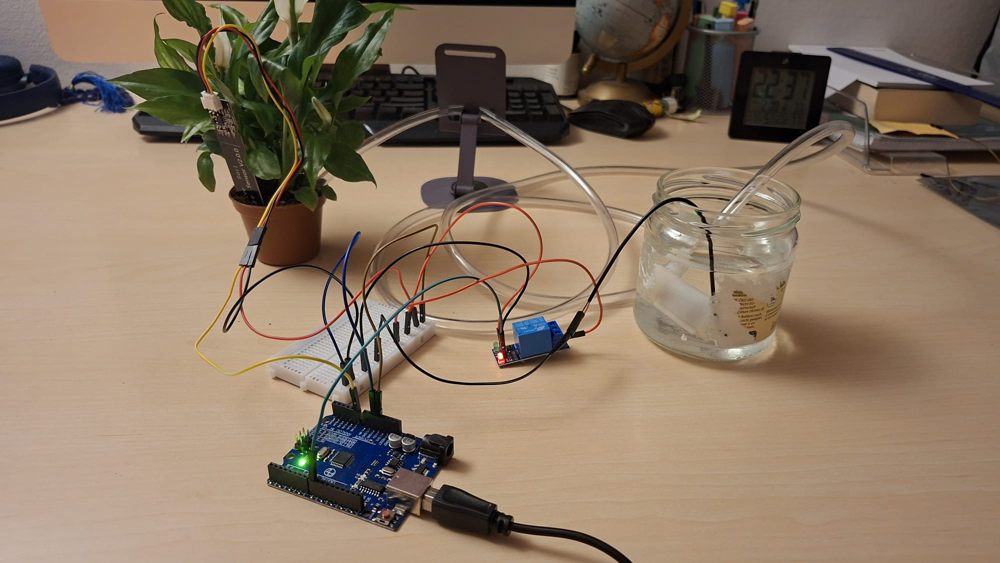

# avr-bare-metal-irrigation
Bare-metal C code for an automated plant waterer, utilizing direct register manipulation on an ATmega328P to control ADC sensors and GPIO relays.

## Project Overview
A closed-loop, automated plant watering system built on an ATmega328P (Arduino Uno R3) utilizing bare-metal C. This project bypasses the standard Arduino hardware abstraction libraries to directly manipulate the microcontroller's memory registers for ADC configuration, GPIO control, and hardware timing.

## Current Status
- [x] Hardware Architecture & Pinout defined
- [x] ADC configured for analog sensor reading
- [x] GPIO configured for relay control
- [x] Main control loop implemented

## Hardware Architecture

### Control Logic (Low Voltage)
* **Microcontroller:** ATmega328P (16MHz)
* **Moisture Sensor:** Analog capacitive/resistive soil sensor
  * `VCC` -> `5V` (Shared Bus)
  * `GND` -> `GND` (Shared Bus)
  * `AOUT` -> `A0` (ADC Channel 0)

### Load Circuit (High Voltage / Actuation)
* **Actuator:** 5V Submersible DC Water Pump (180mA draw)
* **Switching:** 5V Mechanical Relay Module
  * `VCC` -> `5V`
  * `GND` -> `GND`
  * `IN` (Signal) -> Digital Pin `8` (PORTB)

### Engineering Notes: Load Control
The pump is driven by a discrete 5V power rail, switched via a mechanical relay (Normally Open terminal). 
* **Design decision:** While PWM (Pulse Width Modulation) was considered to drop the pump's operating voltage closer to its 4.5V ideal rating, the physical limitations of the mechanical relay (contact degradation/welding at high-frequency switching) precluded this. Instead, a simple binary `HIGH`/`LOW` actuation state is used to drive the pump directly at 5V for short, controlled bursts.

### Engineering Notes: Sensor Latency and Overshoot

A resistive soil sensor does not respond to watering instantly — water needs time to
diffuse through the soil to the probe. A naive loop (read → water → read again) still
measures "dry" seconds after the pump has run, waters again, and floods the plant. That
was the original failure this control logic was written to fix.

The loop compensates in three ways:

* **Burst actuation.** The pump runs a fixed 2 s burst rather than running until the
  sensor reports "wet". The dose is bounded by time, not by a sensor that lags the
  process it measures.
* **Soak delay.** After each burst the loop waits 60 s before the next reading — longer
  than the sensor's settling time. This is the dead-time compensation: the plant can
  never be dosed twice inside one sensor response window.
* **Asymmetric polling.** While the soil reads wet, the loop polls every 10 s; the slow
  60 s path is entered only after actuation, so the system stays responsive without
  stacking doses.

`dry_threshold = 500` on the 10-bit ADC (higher count = drier soil). The ADC prescaler of
128 gives 16 MHz / 128 = 125 kHz, inside the 50–200 kHz window the ATmega328P datasheet
requires for full 10-bit accuracy.

**Known limitation / next step:** a single threshold can chatter when the reading sits
near 500. The fix is hysteresis — start above 500, stop below ~430 — and replacing the
blocking `_delay_ms` calls with a Timer1 overflow ISR so the MCU is free between readings.